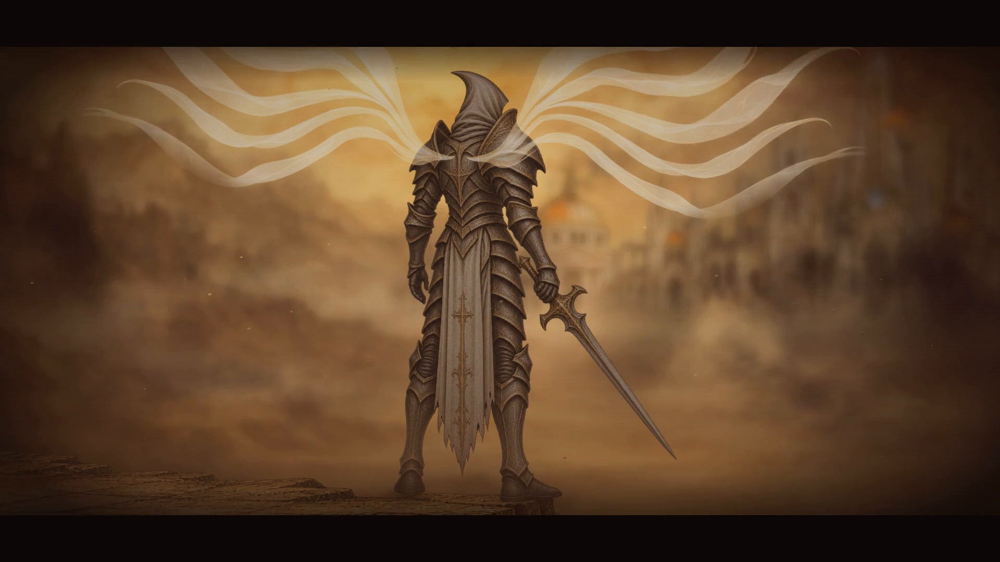
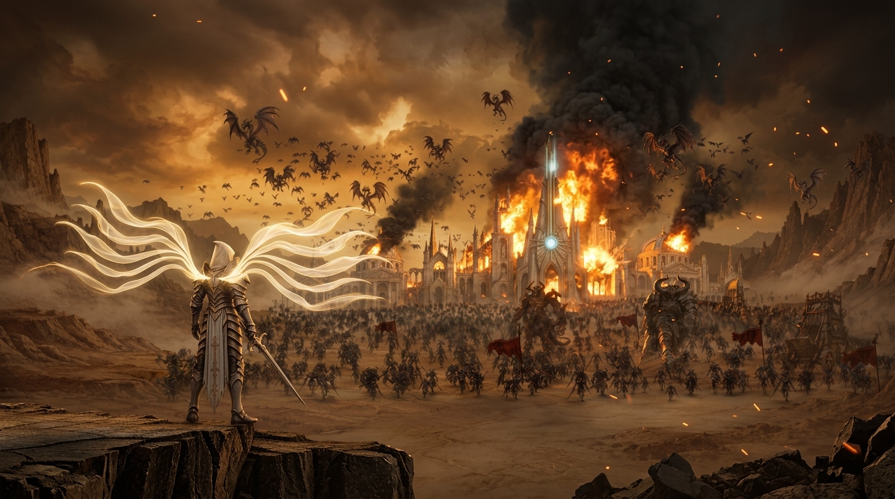
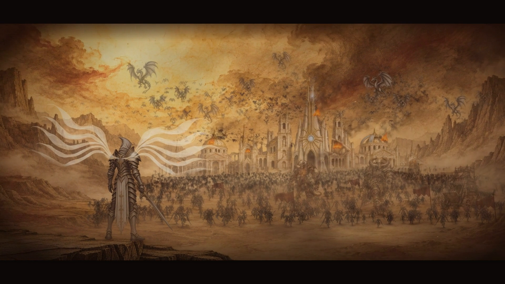
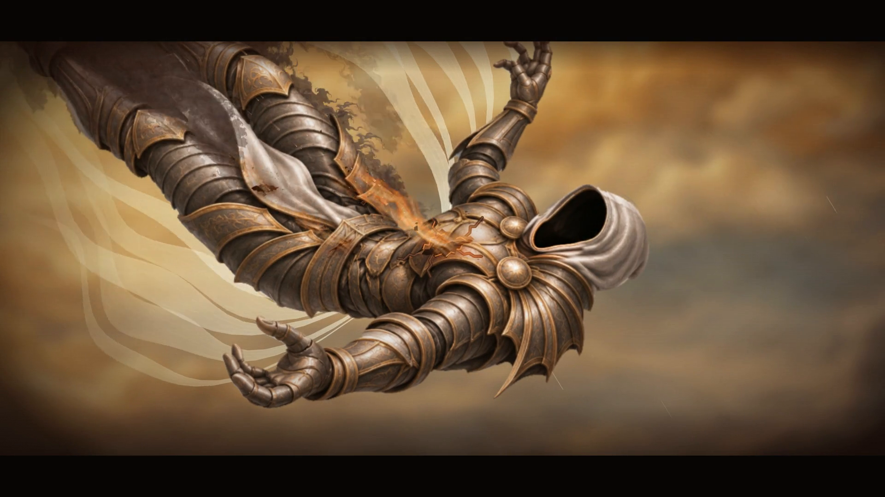
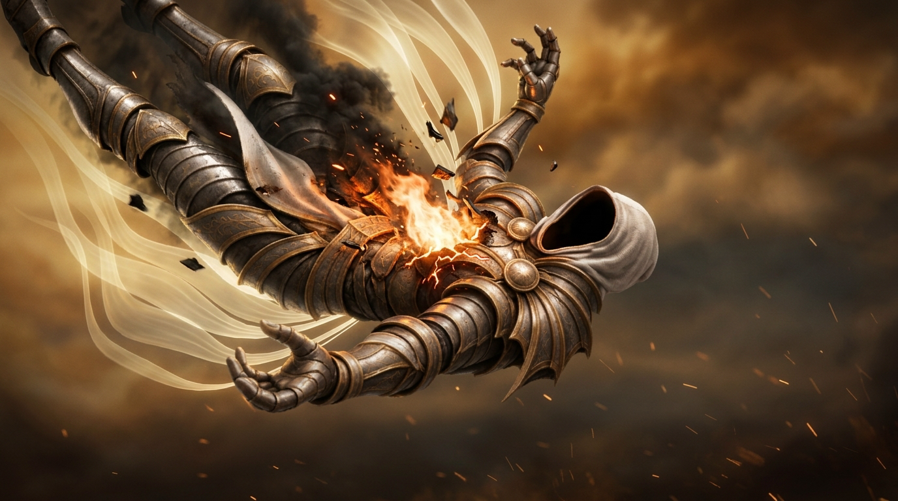
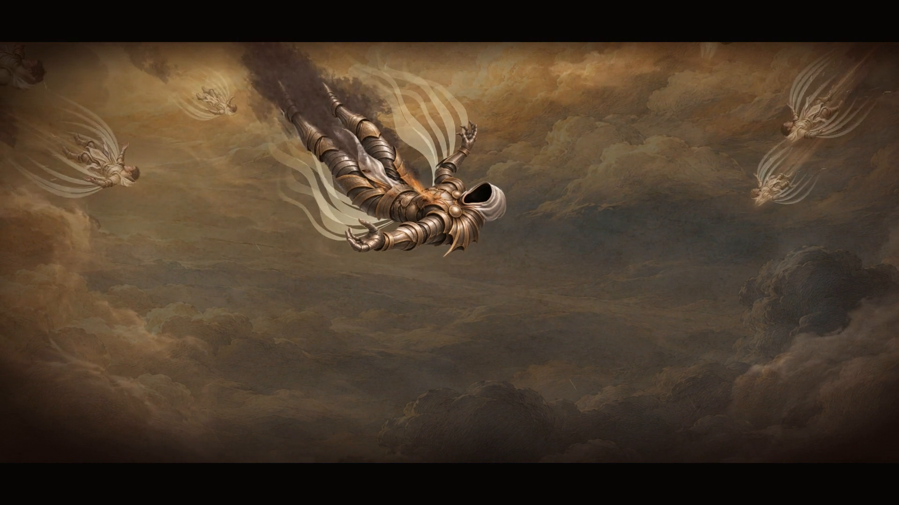

# 《神力之巔》序章前 30 秒 — 電影級復刻分鏡製作手冊

> [!IMPORTANT]
> **給 Gemini 的執行指示**：
> 本文件為《神力之巔》序章前 **30.000 秒（1920×1080、30 fps、共 900 幀）** 的電影級復刻分鏡規格，嚴格鎖定原片 [shots-01-05-replay.mp4](./shots-01-05-replay.mp4) 的鏡頭切換與 BGM 節拍點。
> 請依照下方 **Clip 01 ～ Clip 04** 各自指定的「原片構圖基準圖」、「電影風格基準圖」與對應的 **影片生成 Prompt**，依序（或依使用者指定的段落）生成 4 段 16:9 AAA 寫實暗黑奇幻 3D CGI 電影影片。
> - 每一段皆為 **單一連續一鏡到底（single continuous unbroken shot）**，**禁止任何剪接轉場、文字、字幕或黑邊**。
> - 每段皆需以「圖 1（原片構圖基準）」鎖定起始構圖與角色站位／姿態，並將畫質與光影材質全面升級為「圖 2（電影風格基準）」的 AAA 3D CG 電影水準。

---

## 總覽：30 秒精確幀數卡點表（30 fps）

| 段落代號 | 對應原片時間 | 精確幀數範圍 | 目標長度 | 核心節拍點（對齊 BGM） | 檔名（合成輸入用） |
|---|---|---|---|---|---|
| **Clip 01 (Shot 1A)** | `00:00.000 – 00:08.000` | 幀 `0 – 239` | 8.00s（含 0.35s 尾端微疊） | `00:00` 鐘鳴起拍、天使抬頭；`00:04` 兩段拉遠揭露聖殿與魔軍 | `clip_01_shot1a.mp4` |
| **Clip 02 (Shot 1B)** | `00:08.000 – 00:16.000` | 幀 `240 – 479` | 8.00s（+ `0.95s` 疊化尾段） | **`00:11.72`（段內第 3.72s / 幀 352）主塔遇襲爆炸、聖光熄滅** | `clip_02_shot1b.mp4` |
| **疊化轉場** | `00:16.000 – 00:16.950` | 幀 `480 – 508` | 0.95s（29 幀） | 由 `assemble_30s.mjs` 自動以精準 29 幀跨溶解銜接 | （自動合成） |
| **Clip 03 (Shot 2A)** | `00:16.000 – 00:23.000` | 幀 `480 – 689` | 7.00s | `00:16.95` 重鼓點進入燃火大天使長仰面墜落特寫 → 開始拉遠 | `clip_03_shot2a.mp4` |
| **Clip 04 (Shot 2B)** | `00:23.000 – 00:30.000` | 幀 `690 – 899` | 7.00s | `00:23.00` 群翼火流星墜入深淵雲海；**`00:27.5–30.0` 灼焦白羽掠鏡** | `clip_04_shot2b.mp4` |

> [!TIP]
> **參考圖檔案位置（已納入 Git 追蹤）**：
> 所有 6 張參考圖皆位於 `opening_animation/cinematic_30s_pack/refs/`，並在下方各段落直接嵌入預覽。若在 Gemini 網頁版上傳本 `.md` 檔時，請將該段落對應的 2 張 PNG 參考圖（或全部 6 張圖）一併夾帶上傳，Gemini 即可直接對照檔名與下方 Prompt 生成影片。

---

## Clip 01｜第一鏡前半：大天使長背影與兩段拉遠（`00:00.00 – 00:08.00`）

- **參考圖 1（原片構圖基準）**：`orig_01_00s50.png`（`opening_animation/cinematic_30s_pack/refs/orig_01_00s50.png`）
- **參考圖 2（電影風格基準）**：`ref_battle.png`（`opening_animation/cinematic_30s_pack/refs/ref_battle.png`）
- **目標運鏡**：`0–4s` 大天使長背影特寫微推、聽見鐘聲微微抬頭 → `4–8s` 鏡頭流暢向左後方拉遠，將大天使長移至畫面左側懸崖，逐步揭露右側遠方燃燒中的至高聖殿與開始湧現的惡魔大軍。

| 參考圖 1：原片構圖基準 (`orig_01_00s50.png`) | 參考圖 2：電影風格基準 (`ref_battle.png`) |
|---|---|
|  |  |

### 給 Gemini 的生成指令（Clip 01 — 請直接依此段 Prompt 生成）
```text
Create an ultra-realistic AAA dark fantasy 3D CGI cinematic 16:9 video in a single continuous unbroken shot (no scene cuts, no text, no subtitles, no black letterbox bars). Use orig_01_00s50.png (first image) as the exact starting composition and character pose, and transform it completely into the photorealistic 3D CGI film quality, brushed metallic armor textures, glowing ethereal golden-white wings, volumetric amber smoke, and epic dark atmosphere of ref_battle.png (second reference image).

[0-4s] Close-up back view of the towering hooded archangel standing on a rocky cliff edge, weathered silver-and-ivory gothic plate armor, radiant golden-white ribbon wings flowing gently from the back armor, holding a glowing longsword downward in the right hand. Hearing a distant war bell, the hooded head slowly tilts upward toward the softly blurred burning celestial cathedral ahead as golden dust and glowing embers drift in the air.
[4-8s] The camera smoothly pulls far back and slightly to the left in one continuous motion, placing the archangel on the far left cliff foreground while revealing the vast apocalyptic battlefield to the right: a monumental gothic white-and-gold celestial cathedral engulfed in fires and black smoke, a massive dark demon horde marching across the valley below, and dark winged demons beginning to swarm the stormy amber sky. Cinematic shallow depth of field, epic volumetric lighting.
```

---

## Clip 02｜第一鏡後半：魔軍壓境與主塔遇襲爆炸（`00:08.00 – 00:16.00`）

- **參考圖 1（原片構圖基準）**：`orig_02_08s00.png`（`opening_animation/cinematic_30s_pack/refs/orig_02_08s00.png`）
- **參考圖 2（電影風格基準）**：`ref_battle.png`（`opening_animation/cinematic_30s_pack/refs/ref_battle.png`）
- **核心卡點**：**段內第 `3.7s`（對應全片 `11.72s` 第 352 幀）** 至高聖殿中央主塔遭隕石／重擊轟爆，聖光熄滅，黑煙與熾熱火星掠過前景。

| 參考圖 1：原片構圖基準 (`orig_02_08s00.png`) | 參考圖 2：電影風格基準 (`ref_battle.png`) |
|---|---|
|  |  |

### 給 Gemini 的生成指令（Clip 02 — 請直接依此段 Prompt 生成）
```text
Create an ultra-realistic AAA dark fantasy 3D CGI cinematic 16:9 video in a single continuous unbroken wide shot (no scene cuts, no text, no subtitles, no black letterbox bars). Use orig_02_08s00.png (first image) as the exact wide battlefield composition, and transform it completely into the photorealistic 3D CGI film quality, dramatic firelight, metallic textures, and epic dark fantasy realism of ref_battle.png (second reference image).

[0-3.7s] Wide epic battlefield shot: the hooded archangel stands motionless on the far-left cliff edge with luminous golden-white ribbon wings waving in the wind, overlooking thousands of horned dark demons and siege beasts marching relentlessly toward the grand gothic celestial cathedral while swarms of dark winged demons circle overhead and flaming meteors streak down through the smoke-filled sky. A radiant pale-blue holy light glows at the center of the main cathedral spire.
[3.7-8s] At 3.7 seconds, a catastrophic fiery blast strikes the top of the central cathedral spire—stone shatters in an explosive shockwave, the pale-blue holy light violently extinguishes, and massive plumes of thick black smoke and orange fire erupt skyward as fiery ash and glowing embers sweep rapidly across the foreground past the archangel. Camera holds steady with subtle shockwave tremble.
```

---

## Clip 03｜第二鏡前半：大天使長燃火仰面墜落（`00:16.00 – 00:23.00`）

- **參考圖 1（原片構圖基準）**：`orig_04_17s20.png`（`opening_animation/cinematic_30s_pack/refs/orig_04_17s20.png`）
- **參考圖 2（電影風格基準）**：`ref_fall.png`（`opening_animation/cinematic_30s_pack/refs/ref_fall.png`）
- **目標運鏡**：`0–4s` 緊跟焦裂起火、黑煙四濺的大天使長仰面失重墜落特寫 → `4–7s` 鏡頭急遽拉遠，帶出周圍一同墜落的燃火天使群與翻湧深淵雲海。

| 參考圖 1：原片構圖基準 (`orig_04_17s20.png`) | 參考圖 2：電影風格基準 (`ref_fall.png`) |
|---|---|
|  |  |

### 給 Gemini 的生成指令（Clip 03 — 請直接依此段 Prompt 生成）
```text
Create an ultra-realistic AAA dark fantasy 3D CGI cinematic 16:9 video in a single continuous unbroken shot (no scene cuts, no text, no subtitles, no black letterbox bars). Use orig_04_17s20.png (first image) as the exact dramatic diagonal falling pose and framing, and transform it completely into the photorealistic 3D CGI film quality, scorched metallic armor reflections, luminous wings, dramatic volumetric fire, and epic abyssal lighting of ref_fall.png (second reference image).

[0-4s] Dramatic close-up of the hooded archangel in scorched, cracked silver-and-gold gothic plate armor falling backward in slow motion diagonally across the frame, face hidden in shadow inside the hood, armored hands reaching desperately upward. Intense roaring orange flames, glowing embers, dark armor debris, and thick black smoke stream violently off the body while luminous golden-white energy ribbon wings trail behind against churning golden-brown and charcoal storm clouds.
[4-7s] The camera rapidly pulls far back from the falling archangel, revealing the massive swirling storm clouds of the abyss below as other flaming angels begin to enter the edges of the frame, plunging downward alongside the archangel.
```

---

## Clip 04｜第二鏡後半：群翼墜落深淵與焦羽掠鏡（`00:23.00 – 00:30.00`）

- **參考圖 1（原片構圖基準）**：`orig_05_23s00.png`（`opening_animation/cinematic_30s_pack/refs/orig_05_23s00.png`）
- **參考圖 2（電影風格基準）**：`ref_fall.png`（`opening_animation/cinematic_30s_pack/refs/ref_fall.png`）
- **核心卡點**：`0–4s` 群翼如火流星沒入黑暗深淵雲海 → **`4.5–7s`（對應全片 `27.5s–30.0s`）一片邊緣灼焦的白色天使羽毛自左上方翻轉飄落，極近距掃過鏡頭正前方。**

| 參考圖 1：原片構圖基準 (`orig_05_23s00.png`) | 參考圖 2：電影風格基準 (`ref_fall.png`) |
|---|---|
|  |  |

### 給 Gemini 的生成指令（Clip 04 — 請直接依此段 Prompt 生成）
```text
Create an ultra-realistic AAA dark fantasy 3D CGI cinematic 16:9 video in a single continuous unbroken shot (no scene cuts, no text, no subtitles, no black letterbox bars). Use orig_05_23s00.png (first image) as the exact high-angle wide abyssal composition, and transform it completely into the photorealistic 3D CGI film quality, dramatic volumetric storm clouds, glowing fire trails, and cinematic depth of ref_fall.png (second reference image).

[0-4s] High-angle epic view looking straight down into a vast, cavernous vortex of churning dark amber and charcoal storm clouds. The burning archangel in the center and a dozen other luminous winged angels across the sky plummet downward like fiery meteors leaving glowing ember trails and smoke wakes as they disappear deep into the dark clouds below.
[4-7s] As the falling angels vanish into the abyssal mist, a single detailed white angel feather with charred, glowing burnt edges tumbles gracefully from the upper-left corner, spinning slowly as it drifts closer and closer until it sweeps right across the extreme foreground directly in front of the camera lens with cinematic bokeh blur.
```

---

## 生成完後的「一鍵幀級精準合成」流程

1. 將 4 支生成完成的 MP4 放入 `opening_animation/cinematic_30s_pack/clips_input/`，並命名為：
   - `clip_01_shot1a.mp4`
   - `clip_02_shot1b.mp4`
   - `clip_03_shot2a.mp4`
   - `clip_04_shot2b.mp4`
2. 執行 `node opening_animation/cinematic_30s_pack/assemble_30s.mjs`，即可自動對齊 **1920×1080、30 fps（共 900 幀）**，於第 480–508 幀（`16.000s–16.950s`）執行 29 幀精準跨溶解疊化，並套回原片 `Desert Ascendant` 30 秒完整混音輸出成片（`opening_animation/cinematic_30s_pack/output_30s_cinematic.mp4`）。
