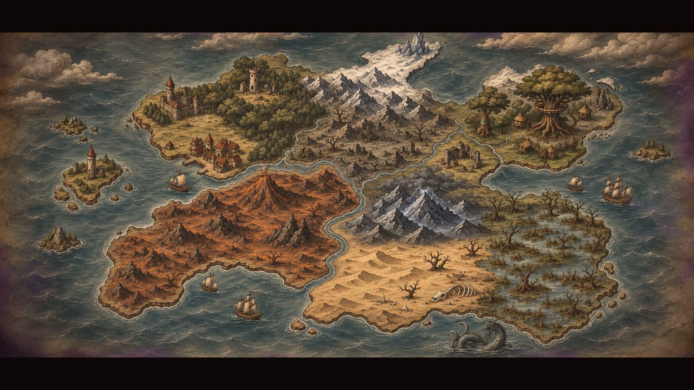
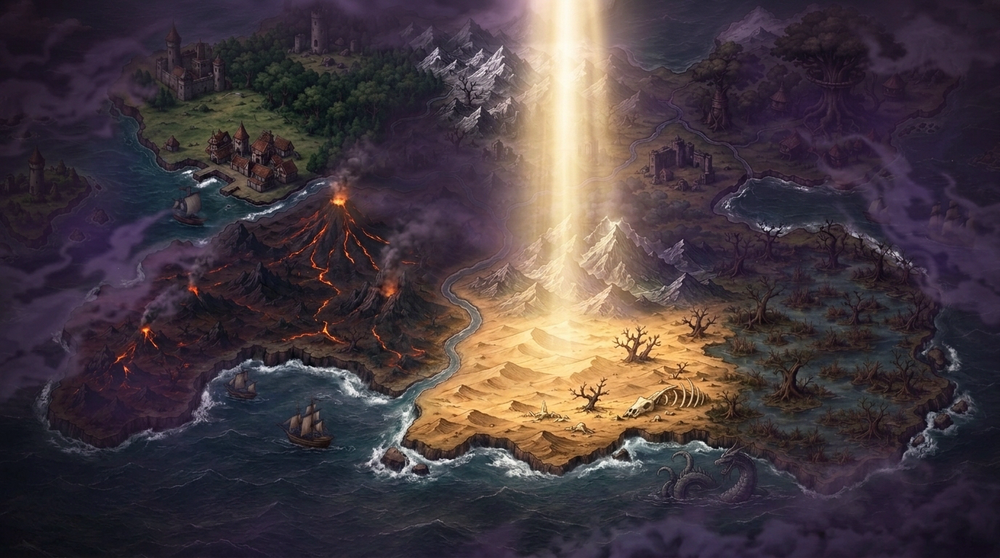
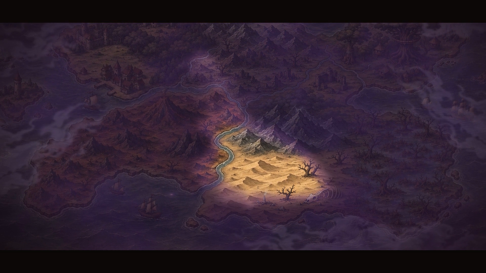
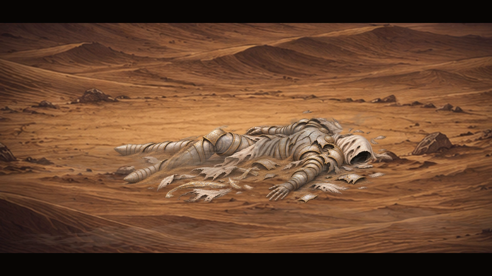
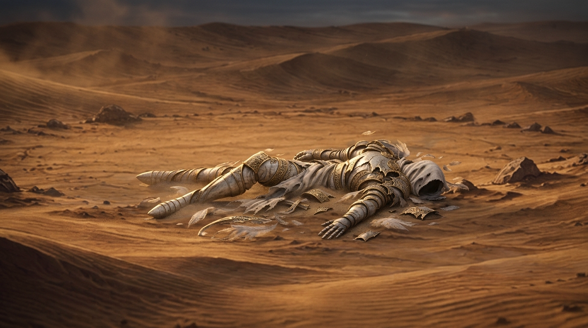
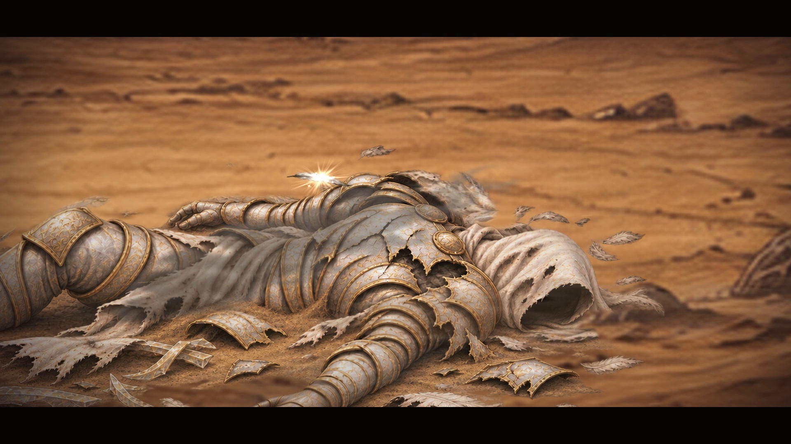
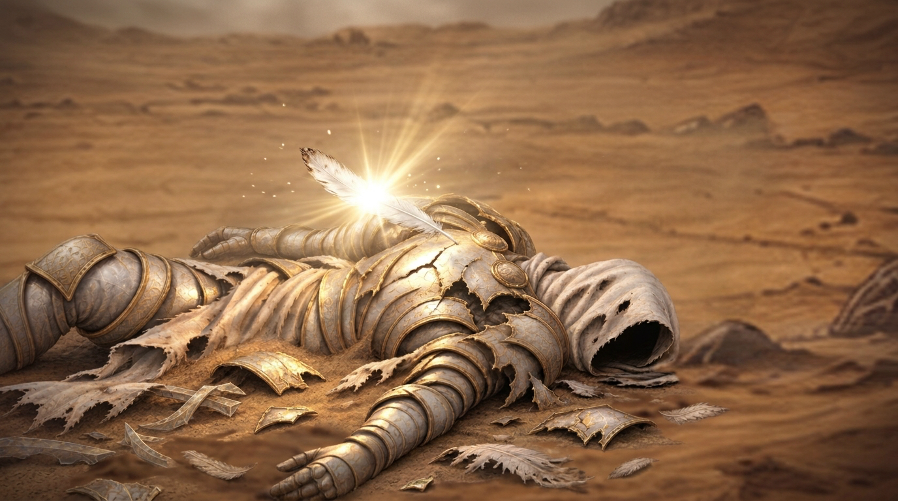

# 《神力之巔》序章第二段（00:34 – 01:09.5）— 電影級復刻分鏡製作手冊

> [!IMPORTANT]
> **給 Gemini 的執行指示**：
> 本文件為《神力之巔》序章 **第二段（原片 `00:34.000 – 01:09.500`，共 35.500 秒 / 1920×1080、30 fps、1065 幀，對應完整 Shot 03）** 的電影級復刻分鏡規格，銜接前 30 秒墜落黑幕之後，嚴格鎖定原片 [shots-01-05-replay.mp4](./shots-01-05-replay.mp4) 的鏡頭節奏與旁白／BGM 卡點。
> 請依照下方 **Clip 05 ～ Clip 08** 各自指定的「原片構圖基準圖」、「電影風格基準圖」與對應的 **生成指令**，依序（或依使用者指定的段落）生成 4 段 16:9 AAA 寫實暗黑奇幻 3D CGI 電影影片。
> - 每一段皆為 **單一連續一鏡到底（single continuous unbroken shot）**，**禁止任何剪接轉場、文字、字幕或黑邊**。
> - 每段皆需以「圖 1（原片構圖基準）」鎖定場景地形／角色倒臥姿勢與構圖，並將畫質全面升級為「圖 2（電影風格基準）」的 AAA 3D CG 電影水準。

---

## 總覽：第二段精確時間軸卡點表（`00:34.00 – 01:09.50`，35.5 秒 / 30 fps）

| 段落代號 | 對應原片時間 | 目標長度 | 核心節拍點（對齊旁白與 BGM） | 檔名（合成輸入用） |
|---|---|---|---|---|
| **Clip 05 (Shot 3A)** | `00:34.000 – 00:43.000` | 9.00s（+0.5s 疊化尾段） | `00:36`「薩爾維恩，黑暗與光明的交界」；`00:41.5`「黑暗逐漸蔓延」，暗紫迷霧自四周吞噬大陸 | `clip_05_shot3a.mp4` |
| **Clip 06 (Shot 3B)** | `00:43.000 – 00:52.000` | 9.00s（+0.5s 疊化尾段） | **`00:46.89`「然而希望之光並未熄滅」**，天降金白聖光柱擊退紫霧 → 鏡頭沿光束俯衝穿雲落入荒漠 | `clip_06_shot3b.mp4` |
| **Clip 07 (Shot 3C)** | `00:52.000 – 01:00.000` | 8.00s（+0.4s 疊化尾段） | 荒漠煙塵散去，露出倒臥沙丘的破損盔甲大天使長 → 高空焦羽翻轉飄落接近 | `clip_07_shot3c.mp4` |
| **Clip 08 (Shot 3D)** | `01:00.000 – 01:09.500` | 9.50s | 焦羽輕觸胸甲、羽軸亮起純白星芒 → **金白色神聖光束爆發並擴張至淹沒全畫面**（銜接第三段 Shot 04） | `clip_08_shot3d.mp4` |

> [!TIP]
> **參考圖檔案位置（已納入 Git 追蹤）**：
> 所有 7 張參考圖皆位於 `opening_animation/cinematic_part2_pack/refs/`，並在下方各段落直接嵌入預覽。傳給 Gemini 時建議**逐段生成**，每次只夾帶該段落指定的 **2 張 PNG**（首段一併附本 `.md` 檔）。

---

## Clip 05｜第三鏡之一：薩爾維恩大陸與暗紫迷霧蔓延（`00:34.00 – 00:43.00`）

- **參考圖 1（原片構圖基準）**：`orig_05_36s50.png`（`opening_animation/cinematic_part2_pack/refs/orig_05_36s50.png`）
- **參考圖 2（電影風格基準）**：`ref_map.png`（`opening_animation/cinematic_part2_pack/refs/ref_map.png`）
- **目標運鏡**：高空神祇視角緩慢掠過並微微推進俯瞰薩爾維恩大陸全貌（西北城堡森林、北方雪峰、西南火山、東南沼澤、南方荒漠）→ `4–9s` 濃稠翻湧的暗紫色腐化迷霧從四周海洋與海岸線湧入，逐步吞噬森林、山脈與城鎮，僅留南方荒漠尚未完全淪陷。

| 參考圖 1：原片構圖基準 (`orig_05_36s50.png`) | 參考圖 2：電影風格基準 (`ref_map.png`) |
|---|---|
|  |  |

### 給 Gemini 的生成指令（Clip 05 — 請直接依此段 Prompt 生成）
```text
Create an ultra-realistic AAA dark fantasy 3D CGI cinematic 16:9 video in a single continuous unbroken high-altitude aerial shot (no scene cuts, no text, no subtitles, no black letterbox bars). Use orig_05_36s50.png (first image) as the exact island continent geography and framing, and transform the illustrated map completely into the breathtaking photorealistic 3D CGI aerial world, realistic ocean waves, volumetric clouds, mountains, castles, forests, and cinematic atmosphere of ref_map.png (second reference image).

[0-4s] Sweeping high-altitude god's-eye aerial shot slowly drifting and pushing gently over the vast fantasy island continent of Salveon surrounded by dark ocean waters and sailing ships: medieval stone castles and dense forests in the northwest, rugged snow-capped mountain peaks in the north, a charred volcanic peninsula in the southwest, murky dead-tree swamps in the southeast, and a golden sand-dune desert with a giant bleached ribcage in the central-south. Soft drifting clouds cast shadows over the realistic 3D landscape.
[4-9s] Thick, billowing volumetric dark-purple corruption mist and ominous storm clouds surge aggressively inward from the outer ocean edges, rolling over the coastlines, swallowing the castles, forests, volcanic ridges, and swamps in deep violet shadow while lightning flickers faintly inside the dark fog—leaving only the central-south golden desert not yet consumed. Epic cinematic scale and atmospheric lighting.
```

---

## Clip 06｜第三鏡之二：天降希望神光、驅散紫霧並俯衝荒漠（`00:43.00 – 00:52.00`）

- **參考圖 1（原片構圖基準）**：`orig_06_46s00.png`（`opening_animation/cinematic_part2_pack/refs/orig_06_46s00.png`）
- **參考圖 2（電影風格基準）**：`ref_map.png`（`opening_animation/cinematic_part2_pack/refs/ref_map.png`）
- **核心卡點**：`0–3.5s` 天際劈下一道耀眼金白聖光柱直落南方荒漠、衝擊波將暗紫迷霧逼退成圓形神聖結界 → `3.5–9s` 鏡頭沿著金色光束急速向下俯衝，穿過翻湧的雲層與漫天金色沙塵，無縫降落至荒漠地表。

| 參考圖 1：原片構圖基準 (`orig_06_46s00.png`) | 參考圖 2：電影風格基準 (`ref_map.png`) |
|---|---|
|  |  |

### 給 Gemini 的生成指令（Clip 06 — 請直接依此段 Prompt 生成）
```text
Create an ultra-realistic AAA dark fantasy 3D CGI cinematic 16:9 video in a single continuous unbroken aerial dive shot (no scene cuts, no text, no subtitles, no black letterbox bars). Use orig_06_46s00.png (first image) as the exact starting composition of the dark purple mist surrounding the illuminated southern desert, and render it entirely in the photorealistic 3D CGI film quality, volumetric lighting, and dramatic realism of ref_map.png (second reference image).

[0-3.5s] High-altitude aerial view over the purple-mist-shrouded continent: a brilliant, blazing pillar of golden-white heavenly light pierces straight down from the storm clouds onto the central-south golden desert. A radiant shockwave pushes the swirling dark-purple corruption mist back into a glowing circular sanctuary ring, bathing the golden sand dunes and winding river in warm divine light.
[3.5-9s] The camera locks onto the glowing impact point in the golden desert and dives rapidly downward along the fading beam of light, rushing smoothly through layers of dramatic clouds and swirling golden desert dust until descending close to the windswept ochre sand dunes below as heavy dust clouds billow across the desert floor. Cinematic motion blur and epic volumetric rays.
```

---

## Clip 07｜第三鏡之三：煙塵散去顯現倒臥大天使長與焦羽飄落（`00:52.00 – 01:00.00`）

- **參考圖 1（原片構圖基準）**：`orig_07_56s00.png`（`opening_animation/cinematic_part2_pack/refs/orig_07_56s00.png`）
- **參考圖 2（電影風格基準）**：`ref_desert_fallen.png`（`opening_animation/cinematic_part2_pack/refs/ref_desert_fallen.png`）
- **目標運鏡**：`0–4s` 荒漠沙塵與濃煙隨強風散去，逐漸顯露出倒臥在沙丘中央的大天使長（破損焦裂的銀白金邊板甲沾滿黃沙、破爛白布隨風獵獵翻飛）→ `4–8s` 鏡頭緩慢平穩向前推進，同時一片邊緣灼焦、微微發光的白色天使羽毛自畫面上方緩緩翻轉飄落，朝倒臥的胸甲降下。

| 參考圖 1：原片構圖基準 (`orig_07_56s00.png`) | 參考圖 2：電影風格基準 (`ref_desert_fallen.png`) |
|---|---|
|  |  |

### 給 Gemini 的生成指令（Clip 07 — 請直接依此段 Prompt 生成）
```text
Create an ultra-realistic AAA dark fantasy 3D CGI cinematic 16:9 video in a single continuous unbroken shot (no scene cuts, no text, no subtitles, no black letterbox bars). Use orig_07_56s00.png (first image) as the exact wide desert composition and fallen archangel pose, and transform it completely into the photorealistic 3D CGI film quality, brushed weathered metallic armor, fine sand grain textures, and dramatic desert lighting of ref_desert_fallen.png (second reference image).

[0-4s] Wide cinematic shot of a vast, windswept golden-ochre desert floor: thick clouds of drifting sand and dust blow away to reveal the motionless hooded archangel lying face-up diagonally across the sand, legs to the left and shadowed ivory hood to the right. The battle-damaged silver-and-ivory gothic plate armor with antique gold filigree is cracked and dusted with sand; tattered cloth strips and broken armor shards flutter gently in the harsh desert wind.
[4-8s] The camera slowly and smoothly glides forward closer toward the fallen archangel as a single detailed white angel feather with charred edges and a faint pure-white shimmer drifts down gracefully from the upper sky, tumbling slowly in the wind toward the archangel's cracked chestplate. Cinematic shallow depth of field, fine windblown sand particles, moody golden dusk atmosphere.
```

---

## Clip 08｜第三鏡之四：焦羽落胸、星芒點燃與希望金光爆發（`01:00.00 – 01:09.50`）

- **參考圖 1（原片構圖基準）**：`orig_08_63s00.png`（`opening_animation/cinematic_part2_pack/refs/orig_08_63s00.png`）
- **參考圖 2（電影風格基準）**：`ref_feather_glow.png`（`opening_animation/cinematic_part2_pack/refs/ref_feather_glow.png`）
- **核心卡點**：`0–3s` 焦羽自上方飄落輕觸破損胸甲、羽軸中央亮起純白星芒 → `3–7s` 觸甲瞬間迸發耀眼金白放射光束與光粒、鏡頭緩緩推進 → **`7–9.5s` 神聖金白光芒劇烈擴張並徹底淹沒全畫面**（完美銜接第三段 Shot 04 開場）。

| 參考圖 1：原片構圖基準 (`orig_08_63s00.png`) | 參考圖 2：電影風格基準 (`ref_feather_glow.png`) |
|---|---|
|  |  |

### 給 Gemini 的生成指令（Clip 08 — 請直接依此段 Prompt 生成）
```text
Create an ultra-realistic AAA dark fantasy 3D CGI cinematic 16:9 video in a single continuous unbroken medium close-up shot (no scene cuts, no text, no subtitles, no black letterbox bars). Use orig_08_63s00.png (first image) as the exact medium close-up framing of the fallen archangel's cracked chestplate and tattered hood, and transform it completely into the photorealistic 3D CGI film quality, intricate gold-filigree metal reflections, glowing volumetric rays, and cinematic bloom of ref_feather_glow.png (second reference image).

[0-3s] Dramatic medium close-up of the fallen hooded archangel lying motionless in windswept desert sand, face hidden in pitch-black shadow inside the torn ivory hood. A single detailed white angel feather with charred edges floats gently down from above, a tiny pure-white star spark glowing at the center of its shaft as it softly touches down onto the cracked ivory-and-gold chestplate.
[3-7s] Upon touching the armor, the white star flare violently ignites into dazzling golden-white volumetric light rays, shimmering energy particles, and warm divine shockwaves radiating outward from the feather across the metallic filigree and lifting sand grains into the air as the camera slowly pushes closer.
[7-9.5s] The radiant golden-white light intensifies and expands rapidly from the chestplate like a rising sun, blooming brighter and brighter until warm luminous golden-white light completely fills the entire frame. Epic AAA cinematic lighting and lens bloom.
```

---

## 生成完後的「一鍵幀級精準合成」流程

1. 將 4 支生成完成的 MP4 放入 `opening_animation/cinematic_part2_pack/clips_input/`，並命名為：
   - `clip_05_shot3a.mp4`
   - `clip_06_shot3b.mp4`
   - `clip_07_shot3c.mp4`
   - `clip_08_shot3d.mp4`
2. 執行 `node opening_animation/cinematic_part2_pack/assemble_part2.mjs`，即可自動對齊 **1920×1080、30 fps（35.500 秒 / 1065 幀）**，自動加上平滑跨溶解轉場，並同步混入原片 `00:34.00 – 01:09.50` 的音效（`shots-01-05-replay-sfx.mp3`）與 BGM（`desert-ascendant.mp3`），輸出成片 `opening_animation/cinematic_part2_pack/output_part2_cinematic.mp4`。
