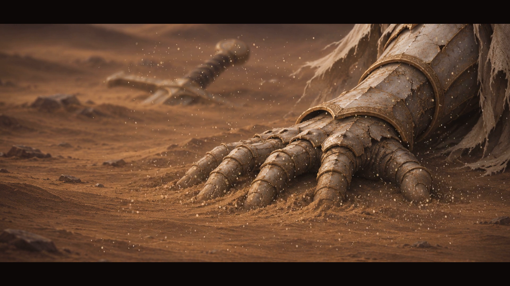
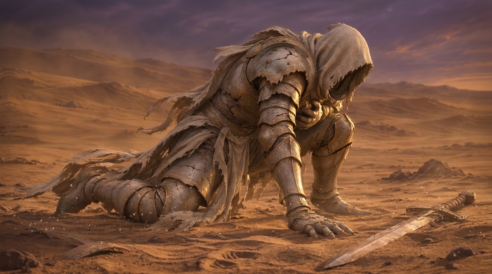
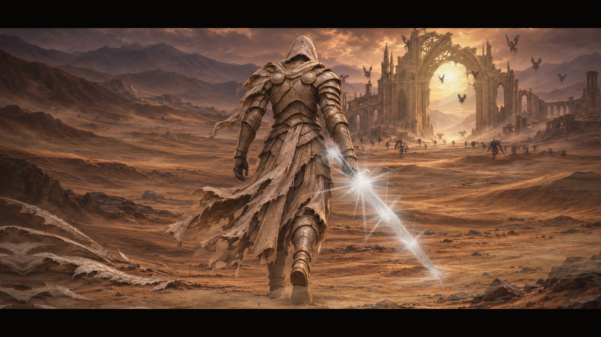

# 《神力之巔》序章第三部終章（01:09.5 – 01:54.4）— 電影級復刻分鏡製作手冊

> [!IMPORTANT]
> **給 Gemini 的執行指示**：
> 本文件為《神力之巔》序章 **第三部終章（對應原片 Shot 04 撐地起身舉劍 ＋ Shot 05 荒漠孤身迎戰終章，合成全長 34.000 秒 / 1920×1080、30 fps、1020 幀）** 的電影級復刻分鏡規格，銜接第二部結尾胸口希望金光爆發之後，一路推進至全片淡黑收尾。
> 請依照下方 **Clip 09 ～ Clip 12** 各自指定的「原片構圖基準圖」、「電影風格基準圖」與對應的 **生成指令**，依序生成 4 段 16:9 AAA 寫實暗黑奇幻 3D CGI 電影影片。
> - 每一段皆為 **單一連續一鏡到底（single continuous unbroken shot）**，**禁止任何剪接轉場、文字、字幕或黑邊**。
> - 每段皆嚴格遵守人體與裝甲結構（**絕不多生手腳或手指**、鎧甲碎布隨風自然飄動但不讓金屬四肢變形），並以「圖 1」鎖定構圖、「圖 2」升級為 AAA 3D CG 電影畫質。

---

## 總覽：第三部終章精確時間軸卡點表（34.0 秒 / 30 fps）

| 段落代號 | 對應原片區段與旁白 | 目標長度 | 核心節拍點 | 檔名（合成輸入用） |
|---|---|---|---|---|
| **Clip 09 (Shot 4A)** | Shot 4 開場（`01:11`「凝聚最後的力量」） | 8.00s（+0.5s 疊化） | 右手鎧甲重重撐入黃沙、五指抓地、細沙滑落、遠處長劍半埋沙中，金色光粒自指縫升起 | `clip_09_shot4a.mp4` |
| **Clip 10 (Shot 4B)** | Shot 4 中段（`01:21`「為了守護最後的淨土」） | 8.00s（+0.5s 疊化） | 單膝半跪於荒漠、左手按胸、右手撐地蓄力，破爛白披風在狂風中獵獵翻飛，身體微微抬起準備起身 | `clip_10_shot4b.mp4` |
| **Clip 11 (Shot 4C)** | Shot 4 尾段（`01:28.5`「再次舉起手中之劍」） | 8.00s（+0.5s 疊化） | 側身站起緊握長劍、黃沙自劍刃傾瀉而下，白色光粒環繞周身升騰、披風狂舞 | `clip_11_shot4c.mp4` |
| **Clip 12 (Shot 5)** | Shot 5 終章（`01:35`「哪怕孤身一人」） | 10.00s（含尾段 3s 淡黑） | 大天使長背影孤身邁步迎向遠方巨型古石拱門與湧現的地面／飛行魔軍，**右手長劍迸發耀眼純白星芒光束** | `clip_12_shot5.mp4` |

> [!TIP]
> **參考圖檔案位置（已納入 Git 追蹤）**：
> 所有 8 張參考圖皆位於 `opening_animation/cinematic_part3_pack/refs/`。傳給 Gemini 時請**另開全新對話**並**逐段生成**，每次只夾帶該段落指定的 **2 張 PNG**（首段一併附本 `.md` 檔）。

---

## Clip 09｜第四鏡之一：右手鎧甲撐地特寫（`00:00.0 – 00:08.0`）

- **參考圖 1（原片構圖基準）**：`orig_09_74s00.png`（`opening_animation/cinematic_part3_pack/refs/orig_09_74s00.png`）
- **參考圖 2（電影風格基準）**：`ref_hand_sand.png`（`opening_animation/cinematic_part3_pack/refs/ref_hand_sand.png`）
- **目標運鏡**：低角度微距特寫，鎧甲右手五指用力扣進荒漠黃沙，細沙從指節滑落、微弱金白光粒自地面升騰，左後方景深散景中可見半埋於沙中的長劍，鏡頭極緩慢微推並伴隨蓄力時的細微震顫。

| 參考圖 1：原片構圖基準 (`orig_09_74s00.png`) | 參考圖 2：電影風格基準 (`ref_hand_sand.png`) |
|---|---|
|  |  |

### 給 Gemini 的生成指令（Clip 09 — 請直接依此段 Prompt 生成）
```text
Create an ultra-realistic AAA dark fantasy 3D CGI cinematic 16:9 video in a single continuous unbroken extreme close-up shot (no scene cuts, no text, no subtitles, no black letterbox bars). Use orig_09_74s00.png (first image) as the exact close-up composition, and transform it completely into the photorealistic 3D CGI film quality, weathered metallic scratches, fine sand physics, and dramatic dusk lighting of ref_hand_sand.png (second reference image).

STRICT ANATOMY LOCK: Strictly ONE armored right hand with exactly FIVE fingers pressing into the sand (no extra fingers, no extra limbs).

[0-4s] Extreme low-angle close-up on the weathered silver-and-gold gothic armored right gauntlet pressing heavily into fine golden-brown desert sand, tattered ivory cloth fluttering off the wrist in the desert wind. In the softly blurred left background, the ornate longsword lies half-buried in the sand.
[4-8s] The armored fingers slowly tighten and dig deeper into the sand with tremendous resolve, displacing fine sand grains as subtle luminous golden-white energy motes begin to drift gently upward around the gauntlet and forearm. The camera slowly pushes in with a subtle cinematic micro-tremor of gathering strength.
```

---

## Clip 10｜第四鏡之二：單膝半跪蓄力（`00:08.0 – 00:16.0`）`[v2 修正版：鎖死方向與單劍]`

- **參考圖 1（原片構圖基準）**：`orig_10_82s50.png`（`opening_animation/cinematic_part3_pack/refs/orig_10_82s50.png`）
- **參考圖 2（電影風格基準）**：`ref_kneel.png`（`opening_animation/cinematic_part3_pack/refs/ref_kneel.png`）
- **修正重點**：**全程嚴格鎖死角色朝向（面朝右）與固定側面機位**，禁止身體突然轉向或鏡頭繞背翻轉；僅做極緩慢的直線微推；畫面中只允許右前景沙面有一把長劍（禁止背景冒出第二把巨劍）。

| 參考圖 1：原片構圖基準 (`orig_10_82s50.png`) | 參考圖 2：電影風格基準 (`ref_kneel.png`) |
|---|---|
|  |  |

### 給 Gemini 的生成指令（Clip 10 v2 — 請直接依此段 Prompt 生成）
```text
Create an ultra-realistic AAA dark fantasy 3D CGI cinematic 16:9 video in a single continuous unbroken medium shot (no scene cuts, no text, no subtitles, no black letterbox bars). Use orig_10_82s50.png (first image) as the exact kneeling composition and pose, and transform it completely into the photorealistic 3D CGI film quality, cracked ivory-silver metallic armor, billowing tattered cloth, and twilight desert lighting of ref_kneel.png (second reference image).

STRICT CAMERA & ORIENTATION LOCK: Keep the exact same side-profile camera angle and body orientation facing right throughout the entire clip. DO NOT turn, flip, or rotate the character's torso or facing direction at any point, and DO NOT orbit the camera around the character. Only a very slow, gentle straight push-in is allowed.
STRICT ANATOMY & PROP LOCK: Strictly TWO arms and TWO legs with natural human proportions (no extra limbs). Strictly ONE ornate longsword lying on the sand in the lower-right foreground (NO second sword in the background).

[0-4s] Steady medium side-profile shot of the hooded archangel kneeling on one knee facing right in the windswept desert sand: right armored hand pressed firmly into the sand beside the single fallen longsword on the lower right, left armored hand resting on the cracked chestplate, face hidden in pitch-black shadow inside the tattered ivory hood. Fierce desert wind whips the torn ivory cloak and waist cloth continuously to the left as subtle golden-white dust motes drift upward.
[4-8s] Maintaining the exact same facing direction and kneeling silhouette without turning, the archangel takes a deep resolute breath, shoulders rising slightly and right armored fingers tightening into the sand as windblown sand sweeps across the dunes and the camera performs a very slow, steady straight push-in.
```

---

## Clip 11｜第四鏡之三：站起握劍、砂落劍刃與白光升騰（`00:16.0 – 00:24.0`）`[v2 修正版：1秒落砂收淨＋禁止多手]`

- **參考圖 1（原片構圖基準）**：`orig_11_88s50.png`（`opening_animation/cinematic_part3_pack/refs/orig_11_88s50.png`）
- **參考圖 2（電影風格基準）**：`ref_rise_sword.png`（`opening_animation/cinematic_part3_pack/refs/ref_rise_sword.png`）
- **修正重點**：
  1. **自然落砂（僅前 1 秒）**：一開場（0.0s）劍刃上已殘留剛從沙地拔起時流下一半的黃沙，並在 **1 秒內全部滑落乾淨**，1.2s 之後劍刃保持潔淨，絕不憑空持續冒沙。
  2. **徹底根治胸前多手**：取消環繞運鏡改為固定四分之三側面微推，並嚴格鎖定「總共只有兩條手臂：右手持劍、左手自然垂於左側身旁，**胸甲上絕不能出現任何手掌**」。

| 參考圖 1：原片構圖基準 (`orig_11_88s50.png`) | 參考圖 2：電影風格基準 (`ref_rise_sword.png`) |
|---|---|
|  |  |

### 給 Gemini 的生成指令（Clip 11 v2 — 請直接依此段 Prompt 生成）
```text
Create an ultra-realistic AAA dark fantasy 3D CGI cinematic 16:9 video in a single continuous unbroken heroic shot (no scene cuts, no text, no subtitles, no black letterbox bars). Use orig_11_88s50.png (first image) as the exact standing combat stance and framing, and transform it completely into the photorealistic 3D CGI film quality, weathered silver-and-gold armor reflections, windblown desert atmosphere, and epic sunset lighting of ref_rise_sword.png (second reference image).

STRICT ANATOMY & CAMERA LOCK: Strictly TWO arms total and TWO legs total. The right arm extends downward gripping ONE ornate longsword; the left arm hangs naturally down at the left side away from the torso—the chestplate is completely bare and unobstructed with NO hand touching the chest and NO extra hand or third arm anywhere. Keep a steady, locked three-quarter side camera angle with only a slow straight push-in (DO NOT orbit or spin the camera around the character).

[0-1.2s] Opening immediately in motion right after lifting the sword from the desert floor: the final remaining half-stream of loose sand already clinging to the steel blade quickly slides off and finishes falling within the first 1 second. By 1.2 seconds, the sword blade is completely clean and dry, and NO more sand ever falls or spawns from the sword for the rest of the video.
[1.2-8s] The hooded archangel stands firmly in the heroic three-quarter profile stance with the clean steel longsword gripped tightly in the right hand as fierce desert wind whips the tattered ivory cloak dramatically to the left. Luminous pure-white and pale-gold light particles gradually awaken and swirl upward around the archangel's armor and blade as the camera holds the steady side angle with a slow, heroic push-in against the stormy purple-and-amber sky.
```

---

## Clip 12｜第五鏡終章：荒漠孤身迎戰古石拱門與聖劍白光（`00:24.0 – 00:34.0`）`[v2 修正版：平滑漸進充能]`

- **參考圖 1（原片構圖基準）**：`orig_12_105s00.png`（`opening_animation/cinematic_part3_pack/refs/orig_12_105s00.png`）
- **參考圖 2（電影風格基準）**：`ref_finale_arch.png`（`opening_animation/cinematic_part3_pack/refs/ref_finale_arch.png`）
- **修正重點**：解決原先 28s→29s 白光突然閃切跳變的問題——強制要求長劍從 `2.5s` 起由劍柄護手**如液態星光般連續、逐幀平滑流淌蔓延至劍尖（2.5s–6.5s）**，到 `6.5s–10s` 穩定綻放純白聖光與旋轉星芒，全程絕無任何瞬間跳切或亮度斷層。

| 參考圖 1：原片構圖基準 (`orig_12_105s00.png`) | 參考圖 2：電影風格基準 (`ref_finale_arch.png`) |
|---|---|
|  |  |

### 給 Gemini 的生成指令（Clip 12 v2 — 請直接依此段 Prompt 生成）
```text
Create an ultra-realistic AAA dark fantasy 3D CGI cinematic 16:9 video in a single continuous unbroken epic finale shot (no scene cuts, no sudden lighting jumps, no text, no subtitles, no black letterbox bars). Use orig_12_105s00.png (first image) as the exact back-view composition facing the giant ruined stone archway, and transform it completely into the photorealistic 3D CGI film quality, dramatic golden volumetric god-rays, swirling desert wind, and epic dark fantasy atmosphere of ref_finale_arch.png (second reference image).

STRICT CONTINUITY LOCK: All lighting and sword-glow transitions MUST be completely smooth, gradual, and continuous frame-by-frame—strictly NO sudden flash-cut, NO abrupt pop-in of full blade glow, and NO visual discontinuity.

[0-2.5s] Epic back-view shot of the lone hooded archangel in battle-worn ivory-silver and gold-filigree gothic plate armor striding steadily forward across the windswept desert toward a colossal, ancient ruined gothic stone archway glowing against a blazing golden-amber stormy sky. The steel longsword in the right hand is completely unlit at first. The tattered ivory cloak whips fiercely to the left in the desert gale as dozens of dark horned ground demons march out from beneath the ruined archway and swarms of winged flying demons flap and circle across the sky above.
[2.5-6.5s] Starting smoothly at 2.5 seconds, a soft pure-white holy glow gently ignites at the sword hilt and crossguard, then flows gradually and continuously down the length of the steel blade toward the tip over four full seconds, steadily increasing in radiance without any sudden jump or flash-cut.
[6.5-10s] Now seamlessly and completely illuminated, the entire longsword radiates a steady, dazzling pure-white starlight aura with delicate luminous light rays and drifting white sparks against the blowing desert sand as the camera continues pushing forward steadily behind the lone hero walking unwaveringly toward the demon horde beneath the towering archway. Epic AAA cinematic finale lighting.
```

---

## 生成完後的「一鍵幀級精準合成」流程

1. 將 4 支生成完成的 MP4 放入 `opening_animation/cinematic_part3_pack/clips_input/`，並命名為：
   - `clip_09_shot4a.mp4`
   - `clip_10_shot4b.mp4`
   - `clip_11_shot4c.mp4`
   - `clip_12_shot5.mp4`
2. 執行 `node opening_animation/cinematic_part3_pack/assemble_part3.mjs`，即可自動對齊 **1920×1080、30 fps（34.000 秒 / 1020 幀）**，開頭由白金柔光淡入、全段平滑跨溶解、尾段 3 秒畫面與雙音軌同步淡出至全黑，輸出 `opening_animation/cinematic_part3_pack/output_part3_cinematic.mp4`。
3. 三部皆驗收完成後，即可一鍵將 **Part 1 + Part 2 + Part 3** 串接為完整電影級序章全片！
