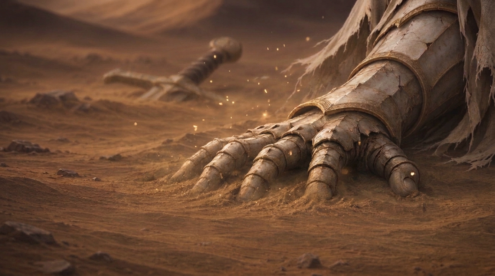
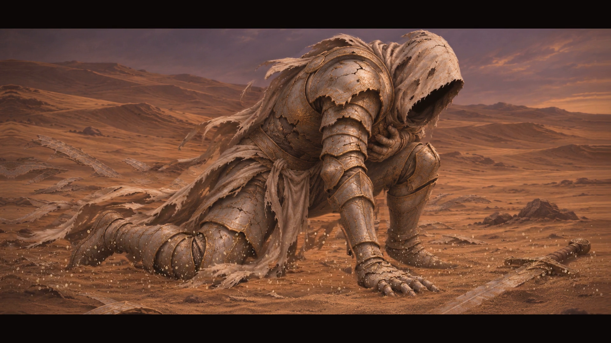
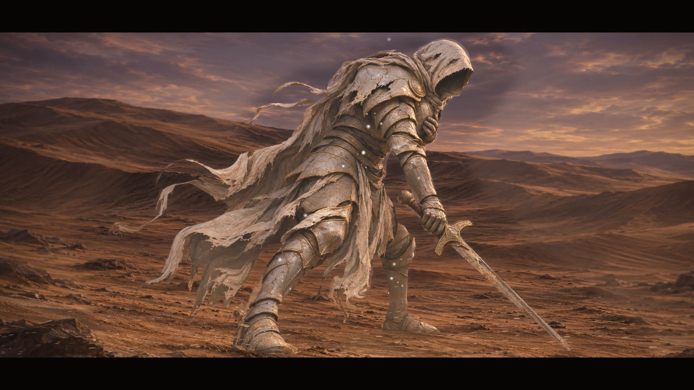
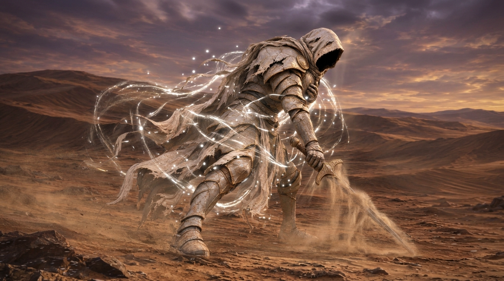
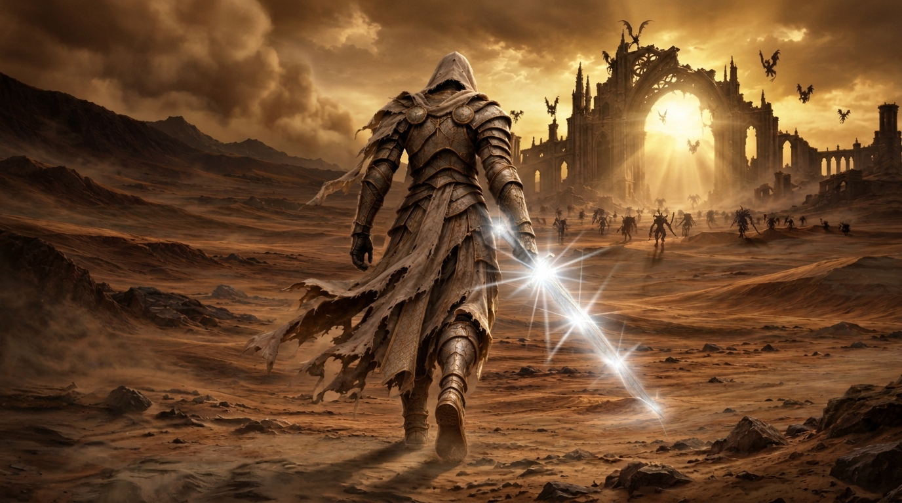

# 《神力之巔》序章第三部終章（01:09.5 – 01:54.4）— 電影級復刻分鏡製作手冊

> [!IMPORTANT]
> **給 Gemini 的執行指示**：
> 本文件為《神力之巔》序章 **第三部終章（對應原片 Shot 04 撐地起身舉劍 ＋ Shot 05 荒漠孤身迎戰終章，合成全長 34.000 秒 / 1920×1080、30 fps、1020 幀）** 的電影級復刻分鏡規格，銜接第二部結尾胸口希望金光爆發之後，一路推進至全片淡黑收尾。
> 請依照下方 **Clip 09 ～ Clip 12** 各自指定的「原片構圖基準圖」、「電影風格基準圖」與對應的 **生成指令**，依序生成 4 段 16:9 AAA 寫實暗黑奇幻 3D CGI 電影影片。
> - 每一段皆為 **單一連續一鏡到底（single continuous unbroken shot）**，**禁止任何剪接轉場、文字、字幕或黑邊**。
> - 每段皆嚴格遵守人體與裝甲結構（**絕不多生手腳或手指**、鎧甲碎布隨風自然飄動但不讓金屬四肢變形），並以「圖 1」鎖定構圖、「圖 2」升級為 AAA 3D CG 電影畫質。

---

## 總覽：第三部終章精確時間軸卡點表（34.0 秒 / 30 fps）

| 段落代號 | 對應原片區段與旁白 | 目標長度 | 核心節拍點 | 檔名（合成輸入用） |
|---|---|---|---|---|
| **Clip 09 (Shot 4A)** | Shot 4 開場（`01:11`「凝聚最後的力量」） | 8.00s（+0.5s 疊化） | 右手鎧甲重重撐入黃沙、五指抓地、細沙滑落、遠處長劍半埋沙中，金色光粒自指縫升起 | `clip_09_shot4a.mp4` |
| **Clip 10 (Shot 4B)** | Shot 4 中段（`01:21`「為了守護最後的淨土」） | 8.00s（+0.5s 疊化） | 單膝半跪於荒漠、左手按胸、右手撐地蓄力，破爛白披風在狂風中獵獵翻飛，身體微微抬起準備起身 | `clip_10_shot4b.mp4` |
| **Clip 11 (Shot 4C)** | Shot 4 尾段（`01:28.5`「再次舉起手中之劍」） | 8.00s（+0.5s 疊化） | 側身站起緊握長劍、黃沙自劍刃傾瀉而下，白色光粒環繞周身升騰、披風狂舞 | `clip_11_shot4c.mp4` |
| **Clip 12 (Shot 5)** | Shot 5 終章（`01:35`「哪怕孤身一人」） | 10.00s（含尾段 3s 淡黑） | 大天使長背影孤身邁步迎向遠方巨型古石拱門與湧現的地面／飛行魔軍，**右手長劍迸發耀眼純白星芒光束** | `clip_12_shot5.mp4` |

> [!TIP]
> **參考圖檔案位置（已納入 Git 追蹤）**：
> 所有 8 張參考圖皆位於 `opening_animation/cinematic_part3_pack/refs/`。傳給 Gemini 時請**另開全新對話**並**逐段生成**，每次只夾帶該段落指定的 **2 張 PNG**（首段一併附本 `.md` 檔）。

---

## Clip 09｜第四鏡之一：右手鎧甲撐地特寫（`00:00.0 – 00:08.0`）

- **參考圖 1（原片構圖基準）**：`orig_09_74s00.png`（`opening_animation/cinematic_part3_pack/refs/orig_09_74s00.png`）
- **參考圖 2（電影風格基準）**：`ref_hand_sand.png`（`opening_animation/cinematic_part3_pack/refs/ref_hand_sand.png`）
- **目標運鏡**：低角度微距特寫，鎧甲右手五指用力扣進荒漠黃沙，細沙從指節滑落、微弱金白光粒自地面升騰，左後方景深散景中可見半埋於沙中的長劍，鏡頭極緩慢微推並伴隨蓄力時的細微震顫。

| 參考圖 1：原片構圖基準 (`orig_09_74s00.png`) | 參考圖 2：電影風格基準 (`ref_hand_sand.png`) |
|---|---|
|  |  |

### 給 Gemini 的生成指令（Clip 09 — 請直接依此段 Prompt 生成）
```text
Create an ultra-realistic AAA dark fantasy 3D CGI cinematic 16:9 video in a single continuous unbroken extreme close-up shot (no scene cuts, no text, no subtitles, no black letterbox bars). Use orig_09_74s00.png (first image) as the exact close-up composition, and transform it completely into the photorealistic 3D CGI film quality, weathered metallic scratches, fine sand physics, and dramatic dusk lighting of ref_hand_sand.png (second reference image).

STRICT ANATOMY LOCK: Strictly ONE armored right hand with exactly FIVE fingers pressing into the sand (no extra fingers, no extra limbs).

[0-4s] Extreme low-angle close-up on the weathered silver-and-gold gothic armored right gauntlet pressing heavily into fine golden-brown desert sand, tattered ivory cloth fluttering off the wrist in the desert wind. In the softly blurred left background, the ornate longsword lies half-buried in the sand.
[4-8s] The armored fingers slowly tighten and dig deeper into the sand with tremendous resolve, displacing fine sand grains as subtle luminous golden-white energy motes begin to drift gently upward around the gauntlet and forearm. The camera slowly pushes in with a subtle cinematic micro-tremor of gathering strength.
```

---

## Clip 10｜第四鏡之二：單膝半跪蓄力（`00:08.0 – 00:16.0`）

- **參考圖 1（原片構圖基準）**：`orig_10_82s50.png`（`opening_animation/cinematic_part3_pack/refs/orig_10_82s50.png`）
- **參考圖 2（電影風格基準）**：`ref_kneel.png`（`opening_animation/cinematic_part3_pack/refs/ref_kneel.png`）
- **目標運鏡**：中景側面構圖，大天使長單膝跪於荒漠黃沙中、右手撐地、左手按住破損胸甲、兜帽下臉孔隱於暗影，長劍橫臥右前景沙面。強風吹得破爛白披風向左獵獵翻飛，微光粒子緩緩升起，鏡頭以緩慢史詩弧線微繞並見角色蓄力微抬肩膀準備起身。

| 參考圖 1：原片構圖基準 (`orig_10_82s50.png`) | 參考圖 2：電影風格基準 (`ref_kneel.png`) |
|---|---|
|  |  |

### 給 Gemini 的生成指令（Clip 10 — 請直接依此段 Prompt 生成）
```text
Create an ultra-realistic AAA dark fantasy 3D CGI cinematic 16:9 video in a single continuous unbroken medium shot (no scene cuts, no text, no subtitles, no black letterbox bars). Use orig_10_82s50.png (first image) as the exact kneeling composition and pose, and transform it completely into the photorealistic 3D CGI film quality, cracked ivory-silver metallic armor, billowing tattered cloth, and twilight desert lighting of ref_kneel.png (second reference image).

STRICT ANATOMY LOCK: Strictly TWO arms and TWO legs with natural human proportions (no extra limbs, no morphing armor).

[0-4s] Dramatic medium shot of the hooded archangel kneeling on one knee in the windswept desert sand: right armored hand pressed firmly into the sand beside the fallen ornate longsword on the right, left armored hand clutching the cracked chestplate, face hidden in pitch-black shadow inside the tattered ivory hood. Fierce desert wind whips the torn ivory cloak and waist cloth rapidly to the left as glowing golden-white dust motes drift upward.
[4-8s] Gathering final resolve, the archangel shifts weight firmly onto the front knee and right gauntlet, shoulders slowly rising slightly in preparation to stand up as windblown sand sweeps across the dunes and the camera executes a slow, heroic subtle arc push-in.
```

---

## Clip 11｜第四鏡之三：站起握劍、砂落劍刃與白光升騰（`00:16.0 – 00:24.0`）

- **參考圖 1（原片構圖基準）**：`orig_11_88s50.png`（`opening_animation/cinematic_part3_pack/refs/orig_11_88s50.png`）
- **參考圖 2（電影風格基準）**：`ref_rise_sword.png`（`opening_animation/cinematic_part3_pack/refs/ref_rise_sword.png`）
- **目標運鏡**：英雄四分之三側面全身構圖，大天使長穩健站立、右手緊握長劍斜指右下，黃沙自劍刃流瀉而下，破爛白披風在狂風中劇烈飛舞，純白與淡金光粒如星塵般環繞全身加速升騰，鏡頭緩慢橫移微仰拍彰顯不屈氣勢。

| 參考圖 1：原片構圖基準 (`orig_11_88s50.png`) | 參考圖 2：電影風格基準 (`ref_rise_sword.png`) |
|---|---|
|  |  |

### 給 Gemini 的生成指令（Clip 11 — 請直接依此段 Prompt 生成）
```text
Create an ultra-realistic AAA dark fantasy 3D CGI cinematic 16:9 video in a single continuous unbroken heroic shot (no scene cuts, no text, no subtitles, no black letterbox bars). Use orig_11_88s50.png (first image) as the exact standing combat stance and framing, and transform it completely into the photorealistic 3D CGI film quality, weathered silver-and-gold armor reflections, windblown sand, and epic sunset lighting of ref_rise_sword.png (second reference image).

STRICT ANATOMY LOCK: Strictly TWO arms and TWO legs, holding ONE ornate longsword in the right hand.

[0-4s] Heroic three-quarter profile shot of the hooded archangel standing firmly in a powerful ready stance across windswept desert dunes, weathered silver-and-ivory gothic plate armor gleaming faintly, face hidden in shadow inside the torn ivory hood. Fine desert sand cascades smoothly off the steel blade of the longsword gripped tightly in the right hand as fierce wind from right to left sends the tattered ivory cloak billowing dramatically behind.
[4-8s] Luminous pure-white and pale-gold light particles intensify and swirl rapidly upward around the archangel's body and sword blade as a soft divine aura begins to awaken across the armor. The camera performs a slow, dramatic low-angle sweeping glide to heighten the heroic resolve against the stormy purple-and-amber sky.
```

---

## Clip 12｜第五鏡終章：荒漠孤身迎戰古石拱門與聖劍白光（`00:24.0 – 00:34.0`）

- **參考圖 1（原片構圖基準）**：`orig_12_105s00.png`（`opening_animation/cinematic_part3_pack/refs/orig_12_105s00.png`）
- **參考圖 2（電影風格基準）**：`ref_finale_arch.png`（`opening_animation/cinematic_part3_pack/refs/ref_finale_arch.png`）
- **核心卡點**：史詩背影大遠景，孤身大天使長迎著狂沙大步走向遠方殘破的巨型哥德式古石拱門——拱門內外湧現大量地面魔軍剪影、空中盤旋著無數拍翼惡魔；**`0–3s` 穩步前行 → `3–10s` 右手長劍從劍柄、護手到整片劍身迸發耀眼純白星芒與緩慢旋轉的放射聖光**，鏡頭緩慢推進並微微環繞，締造全片最高潮終幕！

| 參考圖 1：原片構圖基準 (`orig_12_105s00.png`) | 參考圖 2：電影風格基準 (`ref_finale_arch.png`) |
|---|---|
|  |  |

### 給 Gemini 的生成指令（Clip 12 — 請直接依此段 Prompt 生成）
```text
Create an ultra-realistic AAA dark fantasy 3D CGI cinematic 16:9 video in a single continuous unbroken epic finale shot (no scene cuts, no text, no subtitles, no black letterbox bars). Use orig_12_105s00.png (first image) as the exact back-view composition facing the giant ruined stone archway, and transform it completely into the photorealistic 3D CGI film quality, dramatic golden volumetric god-rays, swirling desert wind, and epic dark fantasy atmosphere of ref_finale_arch.png (second reference image).

[0-3s] Epic back-view shot of the lone hooded archangel in battle-worn ivory-silver and gold-filigree gothic plate armor striding steadily forward across the windswept desert toward a colossal, ancient ruined gothic stone archway glowing against a blazing golden-amber stormy sky. The tattered ivory cloak whips fiercely to the left in the desert gale as dozens of dark horned ground demons march out from beneath the ruined archway and swarms of winged flying demons flap and circle ominously across the bright sky above.
[3-10s] Brilliant, dazzling pure-white holy starlight ignites at the sword hilt and surges down the entire length of the longsword blade in the archangel's right hand, radiating crisp white light rays and a luminous glowing halo that shimmers intensely against the blowing desert sand. The camera slowly pushes forward and gently orbits behind the lone hero walking unwaveringly toward the demon horde beneath the towering archway. Epic AAA cinematic finale lighting.
```

---

## 生成完後的「一鍵幀級精準合成」流程

1. 將 4 支生成完成的 MP4 放入 `opening_animation/cinematic_part3_pack/clips_input/`，並命名為：
   - `clip_09_shot4a.mp4`
   - `clip_10_shot4b.mp4`
   - `clip_11_shot4c.mp4`
   - `clip_12_shot5.mp4`
2. 執行 `node opening_animation/cinematic_part3_pack/assemble_part3.mjs`，即可自動對齊 **1920×1080、30 fps（34.000 秒 / 1020 幀）**，開頭由白金柔光淡入、全段平滑跨溶解、尾段 3 秒畫面與雙音軌同步淡出至全黑，輸出 `opening_animation/cinematic_part3_pack/output_part3_cinematic.mp4`。
3. 三部皆驗收完成後，即可一鍵將 **Part 1 + Part 2 + Part 3** 串接為完整電影級序章全片！
